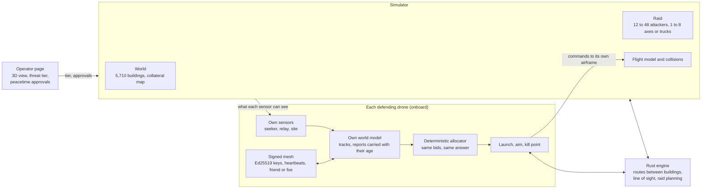

# Architecture

How the submitted version fits together.

## The rule that shapes everything

A drone decides only from what it senses or is told. No decision may read the simulator's true state:
true positions, true identities, which drones are destroyed, or the raid roster. A scanner lists every
place the code reads true state and files it as display, measurement or decision. The test suite fails
if a change adds a decision read.

Unsigned messages are bounded: they can never override what a drone's own seeker holds, carry a time in
the future, or permanently remove a resource.

## Allocation without a leader

Each drone holds its own picture and the signed bids it has heard. It runs the same deterministic
allocator over them. Targets are never ordered by a private name, so two drones holding the same bids
reach the same assignment whatever they call the targets.

## The mesh

Every aircraft has an Ed25519 key. Friend or foe is a signed challenge and response with per-link
session keys. Each drone sends signed heartbeats, and a peer that falls silent is marked lost. Drones
judge who they can reach from their own record of who they have heard, not from a global view of the
radio links.

## Collateral

The collateral map is pre-loaded map data: estimated people exposed per 10 m cell, by day and by night,
with schools, hospitals, clinics, eldercare, childcare and places of worship weighted higher. A net
interceptor scores kill points within 3 s of its earliest possible intercept by where the debris is
predicted to fall, and picks the lowest. It never delays a kill for longer than that.

## Testing and measurement

- Runs are deterministic: the same seed and code give a bit-identical run.
- Each change to decision code was gated by the full test suite, a weakening harness (every decision
  rule is deliberately broken one at a time, and a test must catch each break), and the ground-truth
  scanner.
- Behaviour changes were measured, not asserted: paired runs over 8 or more distinct raids, reported as
  mean ± standard error.
