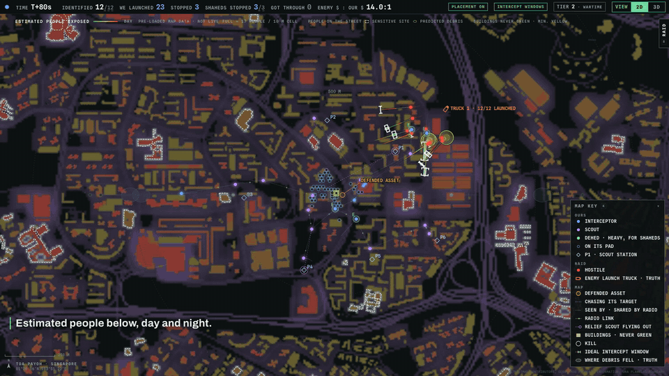
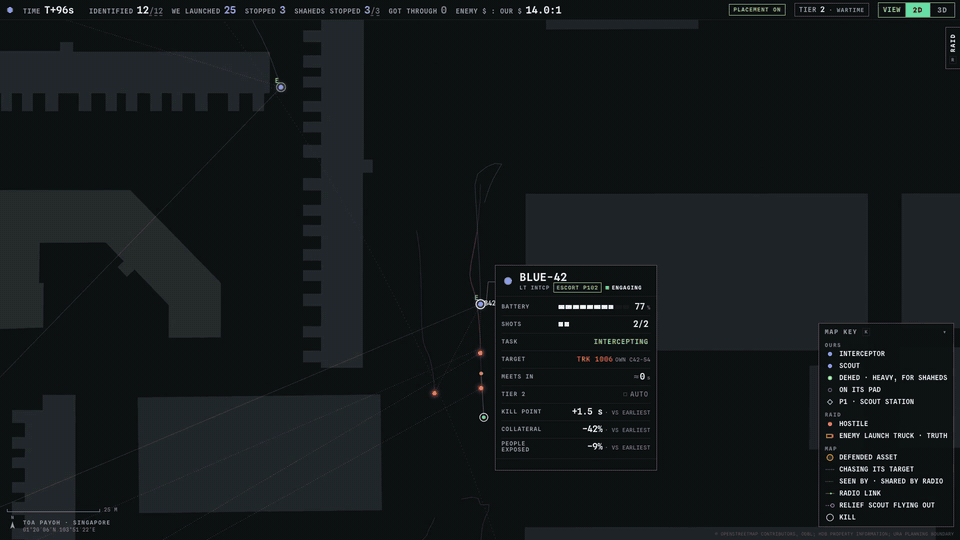
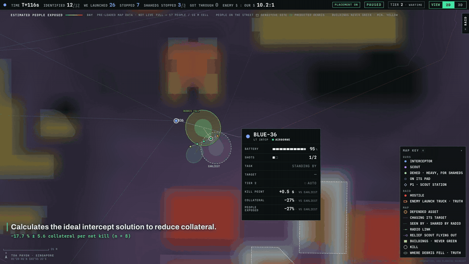

# Garudians: a counter-drone swarm that decides for itself

Curated showcase of our Singapore Defence Tech Hackathon 2026 project (2nd place, Lord of the Rings
track), built in collaboration with Wedgetail Dynamics. The original team repo is private. This repo
holds the write-up, the architecture, demo clips and measured results from the version we submitted.

## The problem

When a salvo of cheap attack drones arrives, someone has to decide within seconds which interceptor
launches and which target each one takes. Today that is usually a pilot or a central ground cue, one
interceptor per target, and the link carrying that cue is the first thing an adversary jams. Among
high-rise blocks no single sensor or radio link sees the whole raid, and where a wreck falls matters.

## What we built

A simulator of Toa Payoh, Singapore (5,710 OpenStreetMap buildings with HDB storey counts, flown
between rather than over), and a defending swarm of scouts and interceptors on rooftop pads. Raids of
12, 24 or 48 attacking drones (quadcopters, Shahed-136 class, or a mix) come in from up to 8
directions, or from trucks inside the estate.

The interceptors decide among themselves, in the air, from what their own sensors see and what their
signed radio mesh tells them. There is no command node. The operator sets the rules of engagement
(the threat tier) instead of flying or assigning each interceptor.

- **Overwatch in the air before the raid.** Scouts hold a jittered ring of stations and hand over to a
  relief scout when their battery runs low, then fly home and recharge.
- **Leaderless allocation.** Every drone runs the same deterministic allocator over its own picture and
  the signed bids it hears. Two drones holding the same bids reach the same answer.
- **Signed mesh.** Each aircraft has its own Ed25519 key. Friend or foe is a signed challenge and
  response, so drones that never met can still prove they are friendly.
- **Losses are noticed, not told.** A shot-down drone is detected from its missed signed heartbeats.
  Its peers work out who is cut off, keep deciding through the gap, and close it by moving.
- **Collateral-aware kill points.** A pre-loaded map estimates people exposed per 10 m cell, by day
  and by night. Each net interceptor picks a kill point within 3 s of its earliest possible intercept
  so the captured drone is predicted to fall on open ground. It still kills early; the map decides
  where, not whether.
- **Heavy interceptor for Shahed-class threats.** Shahed-class threats go to Wedgetail Dynamics'
  DEHED heavy interceptor. It is released automatically only when the swarm's own sensors class the
  contact as Shahed-class, it is identified hostile, and a second, independent drone confirms it with
  its own signed report. Its stock is a briefed loadout sized from the declared threat, never from the
  raid itself. The operator's manual release is a labelled override.
- **Decisions only from what drones sense.** A scanner finds every place the code reads the
  simulator's true state, and a test fails if a decision read is added.
- **Human in the loop by tier.** In peacetime a human approves every launch. In wartime the swarm
  decides, with a deterministic decision-support tool weighing the expected loss of intercepting now
  against not intercepting.

| Estimated people below, day and night | Choosing a lower-collateral kill point |
| --- | --- |
|  |  |

How the pieces fit: [`ARCHITECTURE.md`](ARCHITECTURE.md).

## Measured results

Simulation only. *n* is the number of distinct raids: each seed changes routes, timing, speeds and
bearings. Runs are deterministic, so ± is the standard error between raids, and arms are compared
raid by raid.

Against a one-interceptor-per-target defence with the same sensors and identification (48 attacking
quadcopters from 8 directions, n = 8, 420 s):

| | One per target | Our swarm |
| --- | --- | --- |
| Leaked per raid | 13.6 | 0.2 |
| Stopped, of 48 | 32.8 ± 1.6 | 47.2 ± 0.4 (better on all 8 raids) |
| Sensing to kill, median | | 15.8 ± 3.6 s sooner |
| Rounds per kill | 1.00 | 1.00 |

The gain does not come from firing more rounds.

| Measure | Result | n |
| --- | --- | --- |
| Time from release to identification, per track (overwatch ring) | 28.4 ± 2.1 s sooner from the edge; 47.7 ± 4.5 s sooner for a truck raid | 8 |
| Shaheds stopped, 48-Shahed raid (DEHED release and stock rules) | 20.9 ± 1.3 → 40.5 ± 0.9 of 48, 0 false releases | 8 |
| Collateral index per net kill (mixed 48-drone raid) | 17.7 % ± 5.6 lower | 8 |
| Noisy sensors (range, angle, frame rate), 48 quadcopters | 38.9 ± 1.9 → 47.0 ± 0.2 stopped with fusion over the mesh | 8 |
| Most critical drone shot down at 120 s | 37.1 ± 0.4 against 37.0 ± 0.5 with no loss: no measurable cost | 8 |
| Another round sent after a failed one | 36 of 37 failures | 8 |
| Peacetime launches without human approval | 0 of 639 | 8 per raid size |
| Pad launches at friendlies | 0 of 2,424 decisions | 24 |

These are simulator numbers, not field results.

## Team

Team Garudians:

- **Tommy Quak** (team lead): the simulator, the swarm's onboard decision logic, the test and
  measurement setup, and the demo.
- **Franky Low**: container packaging for the judges' build, and scoring of the identification ramp.
- **Jovan Ong**: the second-sensor plan, the results re-baseline, and the display's role legend.
- **Kalent Chia**: the mentor feedback and rules-of-engagement write-ups, and a raid start-up fix.
- **Reagan Chow**: the pitch deck, the claims review, and the engagement policy probe.

## Status and future plans

**Status.** The clips and results here are from the version we submitted at the hackathon
(September 2026).

**Current work.**

- Rewriting the swarm's decision logic in Rust, so it can run on a drone's own onboard computer.
- Building a hardware command and control (C2) module, so interceptors on real airframes can
  coordinate among themselves with no ground station in the loop.

**Future plans.**

- Finish the Rust rewrite, checking at each step that it gives the same results as the original.
- Try the decision logic on real hardware, where each interceptor decides on board, with no ground
  station in the loop.
- Keep removing places where the simulated drones still rely on information a real drone would not
  have.

Code will be added here once the rewrite settles.
