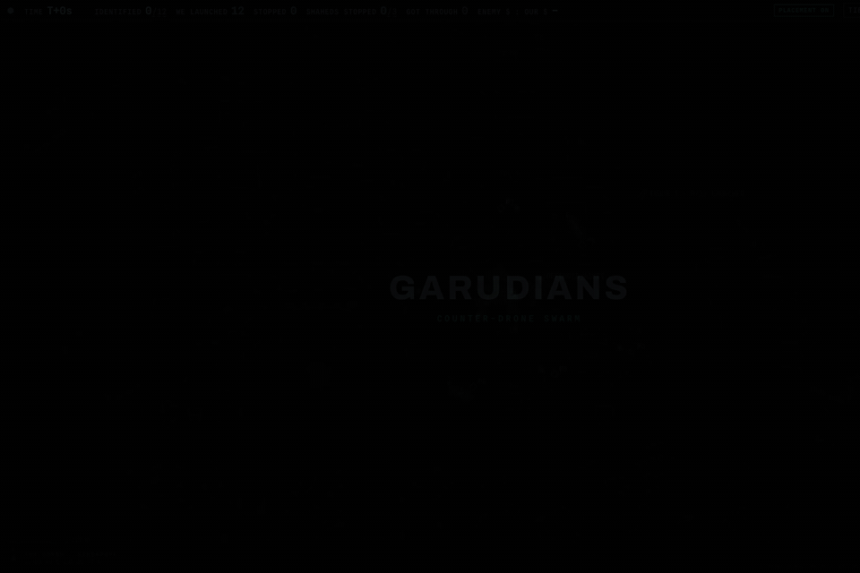

# Garudians: a counter-drone swarm that decides for itself

Curated showcase of our Singapore Defence Tech Hackathon 2026 project (2nd place, Lord of the Rings
track). The original team repo is private. This repo holds the write-up, the architecture, demo clips
and measured results from the version we submitted.

## The problem

When a salvo of cheap attack drones arrives, someone has to decide within seconds which interceptor
launches and which target each one takes. Today that is usually a pilot or a central ground cue, one
interceptor per target, and the link carrying that cue is the first thing an adversary jams. Among
high-rise blocks no single sensor or radio link sees the whole raid, and where a wreck falls matters.

## What we built

A simulator of Toa Payoh, Singapore (5,710 OpenStreetMap buildings with HDB storey counts, flown
between rather than over), and a defending swarm of scouts and interceptors on rooftop pads. Raids of
12, 24 or 48 attacking drones (quadcopters, Shahed-136 class, or a mix) come in from up to 8
directions, or from trucks inside the estate.

The interceptors decide among themselves, in the air, from what their own sensors see and what their
signed radio mesh tells them. There is no command node. The operator sets the rules of engagement
(the threat tier) instead of flying or assigning each interceptor.

- **Overwatch in the air before the raid.** Scouts hold a jittered ring of stations and hand over to a
  relief scout when their battery runs low, then fly home and recharge.
- **Leaderless allocation.** Every drone runs the same deterministic allocator over its own picture and
  the signed bids it hears. Two drones holding the same bids reach the same answer.
- **Signed mesh.** Each aircraft has its own Ed25519 key. Friend or foe is a signed challenge and
  response, so drones that never met can still prove they are friendly.
- **Losses are noticed, not told.** A shot-down drone is detected from its missed signed heartbeats.
  Its peers work out who is cut off, keep deciding through the gap, and close it by moving.
- **Collateral-aware kill points.** A pre-loaded map estimates people exposed per 10 m cell, by day
  and by night. Each net interceptor picks a kill point within 3 s of its earliest possible intercept
  so the captured drone is predicted to fall on open ground. It still kills early; the map decides
  where, not whether.
- **Decisions only from what drones sense.** A scanner finds every place the code reads the
  simulator's true state, and a test fails if a decision read is added.
- **Human in the loop by tier.** In peacetime a human approves every launch. In wartime the swarm
  decides, with a deterministic decision-support tool weighing the expected loss of intercepting now
  against not intercepting.

